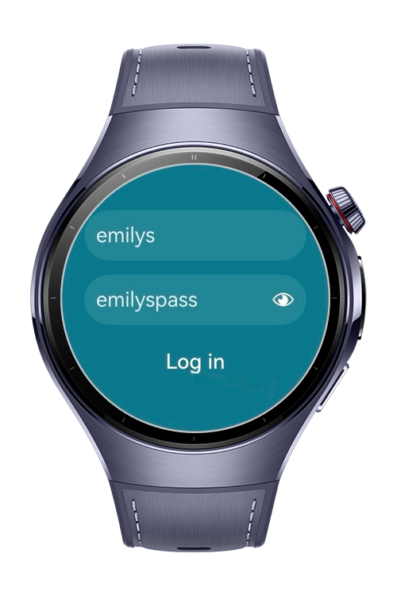
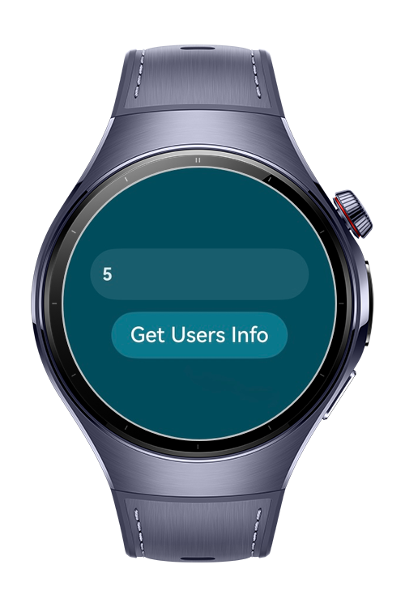
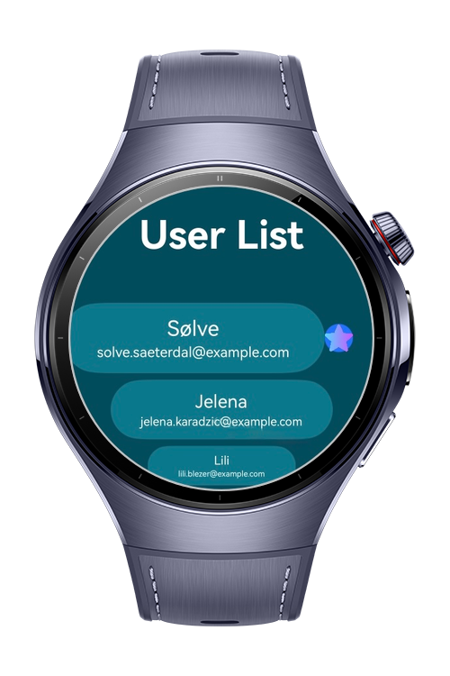
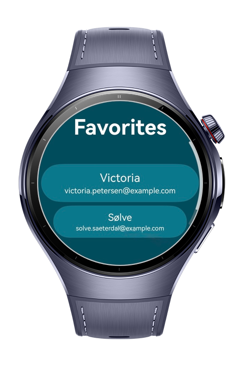

> **Note:** To access all shared projects, get information about environment setup, and view other guides, please visit [Explore-In-HMOS Index](https://github.com/Explore-In-HMOS/hmos-index).

# NearMyContacts
NearMyContacts is a demo application that fetches nearby user data from a remote API and displays it using ArcList components. Users can mark profiles as favorites, which are stored locally in a relational database. The app also provides a favorites page where saved users can be viewed or removed.

# Preview

<p align="left">
  
  
  
  
</p>

# Use Cases
NearMyContacts fetches nearby user data from a remote API.

# Tech Stack
 
**Languages**: ArkTS, ArkUI  
**Frameworks**: HarmonyOS SDK 5.1.0
**Tools**: DevEco Studio 5.1.0
**Libraries/Kits**:
- @kit.RemoteCommunicationKit
- @kit.ArkUI
- @kit.NetworkKit
- @kit.ArkData

# Directory Structure
  ```
   entry/src/main/ets/
   |---pages
   | |---Index.ets                      // Entry/Login page where users input their username and password to authenticate.
   | |---Listing.ets                    // Main page that dynamically fetches a specified number of user data from an API.
   | |---Detail.ets                     // Users saved as favorites by retrieving data from the local database.
   |---model
   | |---RdbModel.ets
   | |---UserModel.ets
   |---service
   | |---DBHelper.ets
   | |---DBService.ets
   |---service
   | |---utils
   |   |---Logger.ets
   |   |---Preferences.ets
   | |---DBConstants.ets
   ```

# Constraints and Restrictions
## Supported Devices
Huawei Watch 5

# LICENSE

NearMyContacts is distributed under the terms of the MIT License.
See the [LICENSE](/LICENSE) for more information.

